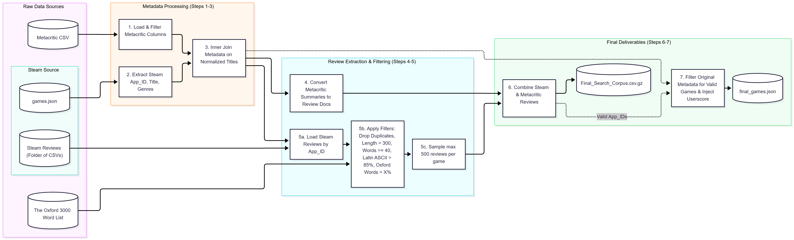
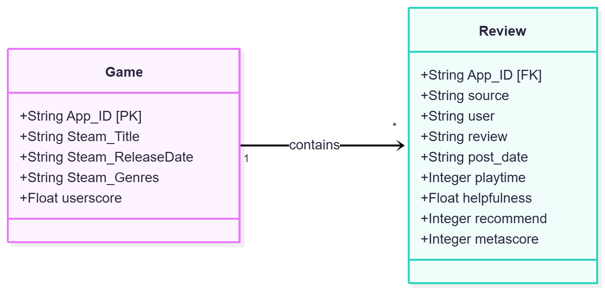
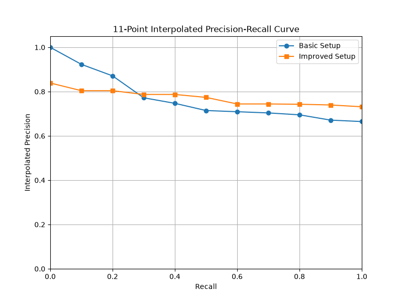

# Information Processing and Retrieval (PRI) - Project

**Course:** Master in Informatics Engineering and Computation (M.EIC), FEUP U.Porto

This project builds a searchable corpus of video-game reviews from Steam and Metacritic, indexes it in Apache Solr, and compares two retrieval setups over nine queries covering technical issues, aspect-based opinions, and game comparisons.

| Milestone | Scope | Status |
|--|--|--|
| [1](#milestone-1-data-preparation) | Data preparation | Complete |
| [2](#milestone-2-indexing-and-retrieval) | Indexing and retrieval | Complete |
| [3](#milestone-3-search-system) | Search system | In progress |

## Milestone 1: Data Preparation

The pipeline combines structured game metadata with unstructured textual reviews from two distinct data sources: Steam and Metacritic.

### Data Processing Pipeline

The data extraction and preparation process is fully automated. It normalizes game titles to find overlapping datasets, standardizes date formats, and aggressively filters raw Steam reviews to build a high-quality corpus for indexing.

#### Filtering & Quality Control

To ensure the final dataset is rich in meaningful textual data and suitable for text-based ad-hoc retrieval, the following filters are applied to the raw Steam reviews:

* **Deduplication:** Removes exact duplicate reviews to prevent spam and biased weightings.
* **Length Threshold:** Drops any review with fewer than 300 characters, ensuring documents have enough semantic density for indexing. Furthermore, we require reviews to have at least 40 words, ensuring the sampled reviews are meaningful.
* **Language & Encoding Verification:** Evaluates the character composition, requiring at least 85% of the text to be standard Latin ASCII (a-z, 0-9). To further filter out non-English reviews and corrupted encodings, we ensured the reviews had a considerable amount of english words (at least 50% should be in the Oxford 3000 Word List).
* **Data Sampling:** Limits Steam reviews to a maximum of 500 per game to manage storage footprint and indexing time while maintaining a large, diverse dataset.
* **Metacritic Curation:** Extracts the Metacritic summaries and injects them as distinct review documents.




### Conceptual Domain Model

The conceptual model centers on a **One-to-Many (1-to-N)** relationship between the physical games and their associated textual reviews.

Both Steam user reviews and Metacritic critical summaries share the `Review` schema. The `source` attribute tracks the origin, allowing for distinct retrieval strategies and query boosting in future milestones.

### Repository Structure & Prerequisites

To run this pipeline, ensure your directory is structured as follows:

```text
.
├── Makefile
├── data/
│   ├── raw/
│   │   ├── Steam/
│   │   │   ├── games.json         # Steam metadata dataset
│   │   │   └── Game Reviews/      # uncompressed Steam reviews
│   │   │       ├── 8980_1910.csv
│   │   │       └── ...
│   │   ├── Metacritic/
│   │   │   └── dataset_metacritic_scraper_2025-02-15.csv
│   │   └── Oxford/
│   │       └── The_Oxford_3000.txt
│   ├── processed/                 # generated corpus and statistics
│   └── solr/                      # generated Solr update batches
├── milestone1/
│   ├── parser.py
│   ├── data_statistics.py
│   ├── splitter.py
│   ├── corpus_analysis.py
│   └── images/
├── milestone2/
│   ├── apply_schema.py
│   ├── prepare_solr.py
│   ├── queries.py
│   ├── evalutate.py
│   ├── schema_basic.json
│   ├── schema_improved.json
│   ├── images/
│   └── results/{basic,improved}/
├── milestone3/                    # work in progress
```

**Requirements:**

* Python 3.x
* Python packages: `pip install pandas matplotlib`
* Docker (and permission to run `sudo docker`) for the Apache Solr 10 container used in Milestone 2

### Usage

Ensure the raw datasets are placed in their respective `data/raw/` directories. You can then run the entire pipeline and view the resulting dataset statistics using the included Makefile:

```bash
# Run the pipeline and generate statistics
make all

# Or run them individually:
make process
make stats
```

### Generated Outputs

Executing the pipeline generates the following outputs:

1. **`Final_Search_Corpus.csv.gz`**: A GZIP-compressed CSV file containing all filtered unstructured textual reviews and their specific metrics (playtime, helpfulness, metascore, source). Compressed to adhere to storage limits while maintaining thousands of textual documents.
2. **`final_games.json`**: A lightweight JSON file containing only the structured metadata (Title, Release Date, Genres, Userscore) for the specific games that successfully passed through the filtering pipeline.
3. **`analysis_output_*.txt`**: A record of the statistics displayed in the user's terminal.

The final dataset includes 456,840 steam reviews and 1,787 Metacritic reviews. Due to its sheer size, we have divided `Final_Search_Corpus.csv.gz` into 3 files, so as to allow their usage in the github environment.

### Datasets & Provenance

This project integrates two distinct datasets to satisfy the requirement of combining structured data with unstructured, rich textual fields.

1. **Steam Reviews Dataset**
   * **Source:** [Mendeley Data - Steam Reviews](https://data.mendeley.com/datasets/jxy85cr3th/2)
   * **Description:** Provides extensive user reviews, playtime metrics, and helpfulness votes from the Steam platform. This serves as our primary source of unstructured textual data for indexing.
   * **Files Used:** `games.json` (metadata) and the nested CSV review files.

2. **Metacritic Games Scrape**
   * **Source:** [Kaggle - Metacritic Games Scrape](https://www.kaggle.com/datasets/zaireali/metacritic-games-scrape)
   * **Description:** Contains structured critical reception data, release dates, and professional summaries for video games.
   * **Files Used:** `dataset_metacritic_scraper_2025-02-15.csv`.

3. **Oxford 3000 Word List**
   * **Source:** [The-Oxford-3000 (Github Repo)](https://github.com/sapbmw/The-Oxford-3000), based on [Oxford Learner's Dictionaries](http://www.oxfordlearnersdictionaries.com/us/wordlist/english/oxford3000/)
   * **Description:** Provides a text file with the 3000 most important English words, one per line.
   * **Files Used:** `The_Oxford_3000.txt`

### Running

```bash
make process   # run the M1 pipeline: build the corpus and final_games.json
make stats     # compute the data characterization from the processed files
make split     # split the review corpus into three files
make clean     # delete processed corpus, metadata and statistics logs
```

## Milestone 2: Indexing and Retrieval

The corpus is indexed in Apache Solr 10 as nested documents: each game is a parent document, and its Steam and Metacritic reviews are child documents under the `review_docs` key. A single collection holds both levels, distinguished by `doc_type`.

Two setups are compared on the same queries:

|Setup|Core|Schema|Review analysis|
|--|--|--|--|
|basic|games_basic|schema_basic.json|text_general|
|improved|games_improved|schema_improved.json|text_en (stopwords, stemming)|

The two setups differ in the analyzer only, as the schemas show. The improved setup also wraps each query in quotes with a slop of 3 (see queries.py), so the comparison of the two setups is not an analyzer-only change.

### Running

```bash
make solr-start             # start the Solr container
make solr-index-basic       # recreate games_basic from schema_basic.json and post the batches
make solr-index-improved    # recreate games_improved from schema_improved.json and post the batches
make solr-count             # print game and review counts for both cores
make solr-stop              # stop the container
```

### Queries and Evaluation

Nine queries are split across three search scenarios:

| Scenario | IDs | Example queries |
|--|--|--|
| Technical issues | S1-a – S1-c | `won't start`, `crashes boot`, `stuck loading` |
| Aspect-based opinions | S2-a – S2-c | `great soundtrack`, `amazing music`, `best sound` |
| Game comparison | S3-a – S3-c | `original better`, `sequel worse`, `downgrade original` |

Run them against both cores and evaluate the results with:

```bash
python3 milestone2/queries.py basic       # writes milestone2/results/basic/dump.txt and results.txt
python3 milestone2/queries.py improved    # writes milestone2/results/improved/dump.txt and results.txt
python3 milestone2/evalutate.py           # MAP, P@30 and precision-recall curves
```

Relevance is recorded manually in `milestone2/results/<setup>/judgements.txt` on a 0–2 scale (0 = not relevant, 1 = partially relevant, 2 = relevant). `evalutate.py` uses these judgements to compute mean average precision (MAP) and precision at 30 (P@30), and plots 11-point interpolated precision–recall curves.

| Setup | MAP | P@30 |
|--|--|--|
| basic | 0.7261 | 0.6148 |
| improved | 0.7300 | 0.7241 |



Per-query curves are available in [`milestone2/images/per_query/`](./milestone2/images/per_query/).

## Milestone 3: Search System

> Work in progress.